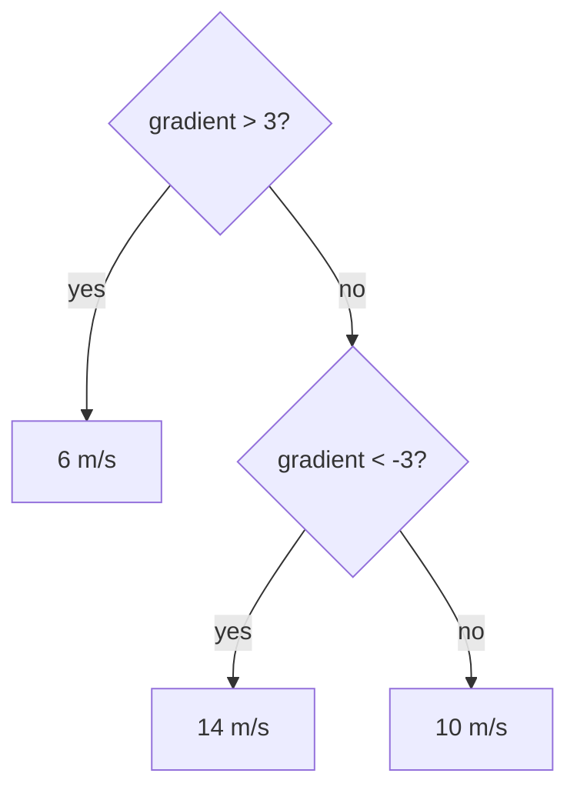

# Making decisions

Real roads go up and down: on a climb you slow down, on a descent you fly. And at some point the race has to end,
when someone crosses the line. Both are questions the game must answer, *is this a climb?* and *has this rider
finished?*, and the answers decide what happens next. This page is about asking questions and acting on the
answers.

## true and false: bool

A question's answer is a **`bool`**: `true` or `false`. Comparisons give one:

| Comparison | Is `true` when |
|---|---|
| `a == b` | `a` equals `b` |
| `a != b` | they differ |
| `a < b`, `a > b` | less than, greater than |
| `a <= b`, `a >= b` | less or equal, greater or equal |

```zig
const gradient_pct: f64 = 5.0;
const climbing = gradient_pct > 3; // a bool: true
```

Numbers of different types compare fine as long as Zig can compare them exactly: a `u32` rider count against an
`f64` limit works. (Floats and `==` are the exception: see [Values and types](/guide/basics/04-values-and-types).)

## Combining questions: and, or, not

| Write | Is `true` when |
|---|---|
| `a and b` | both are true |
| `a or b` | at least one is true |
| `!a` | `a` is false |

They're words, not symbols (`and`, not `&&`). **The order matters**: Zig stops as soon as it knows the answer. In
`a and b`, if `a` is false, `b` is never looked at. That lets the first half protect the second:

```zig
if (i < speeds_mps.len and speeds_mps[i] > 10) {
    std.debug.print("fast\n", .{});
}
```

With `i` at 5 and only 2 speeds, `i < speeds_mps.len` is false, so `speeds_mps[i]` is never read and nothing goes
out of bounds. Swap the two halves and it reads past the end.

## if, else if, else

`if` runs a block only when its condition is `true`; `else` runs otherwise. `else if` asks another question in
between. Zig checks top to bottom and runs only the **first** true branch:



```zig
if (gradient_pct > 3) {
    // climbing
} else if (gradient_pct < -3) {
    // descending
} else {
    // flat enough
}
```

Because the first true branch wins, order the questions from the most specific to the least: a check for steep
climbs (over 8 %) must come *before* the check for climbs (over 3 %), or it never runs.

### Only a bool will do

Some languages treat 0 as false and other numbers as true. Zig doesn't: the condition must be a `bool`.

```zig
if (gradient_pct) { ... }
```

```text
error: expected type 'bool', found 'f64'
```

You say what you mean: `if (gradient_pct > 0)`.

## if as a value

`if` can also *give* a value, which is neat for short choices:

```zig
const speed_mps: f64 = if (gradient_pct > 3) 6.0 else if (gradient_pct < -3) 14.0 else 10.0;
```

Every branch must give the same type of value, and there must be an `else` (otherwise what would it give?):

```text
error: incompatible types: '*const [4:0]u8' and 'comptime_int'
```

That's `if (finished) "done" else 0`: text on one side, a number on the other.

::: tip Try it
Write `const label = if (position_m >= distance_m) "finished" else "riding";` and print it for a rider at
12 500 m of 12 500 m. Then change `>=` to `>`. Which is right for a rider exactly on the line?
:::

## Which decision when

| You want to | Use |
|---|---|
| do something only sometimes | `if (condition) { ... }` |
| choose between two things to do | `if ... else ...` |
| choose between several, in order | `if ... else if ... else ...` |
| choose between values | `const x = if (c) a else b;` |
| choose by what kind of thing a value is | `switch` (in [Enums and switch](/guide/structure/12-enums-and-switch)) |

Long `else if` chains over the same value become hard to read and easy to get out of order; when every branch
compares one value against fixed choices, Part 3's `switch` says it better and the compiler checks you covered
every case.

## In the game

Two decisions join the game. `finished` answers "has this rider crossed the line?" (`>=`, so exactly on the line
counts), and `speedFor` picks a speed from the road's gradient. Below `advance`:

<<< @/code/steps/05-decisions/src/main.zig#finished

<<< @/code/steps/05-decisions/src/main.zig#speed

In `main`, after the rider moves, print the three speeds:

<<< @/code/steps/05-decisions/src/main.zig#main

Their tests, at the end of the file. They check the edges, where bugs hide: a rider exactly on the line, a gradient
of exactly 3 %:

<<< @/code/steps/05-decisions/src/main.zig#tests

Run it (or copy `code/steps/05-decisions`):

```sh
zig build run
```

After the first lines:

```text
flat road:  10 m/s
5% climb:   6 m/s
5% descent: 14 m/s
```

Here's everything, the whole `src/main.zig` after this step:

<<< @/code/steps/05-decisions/src/main.zig

<details>
<summary>What changed since the last step, as a diff</summary>

Lines starting with `+` were added, `-` removed. Only for comparing: copy the code above.

<<< @/code/diffs/05-decisions.diff

</details>

::: tip Check your understanding
Done reading? [Take the lesson →](/learn/basics/05-making-decisions) Quizzes on what you just read, a snippet to predict, a bug to fix, and
this step to build yourself.
:::
