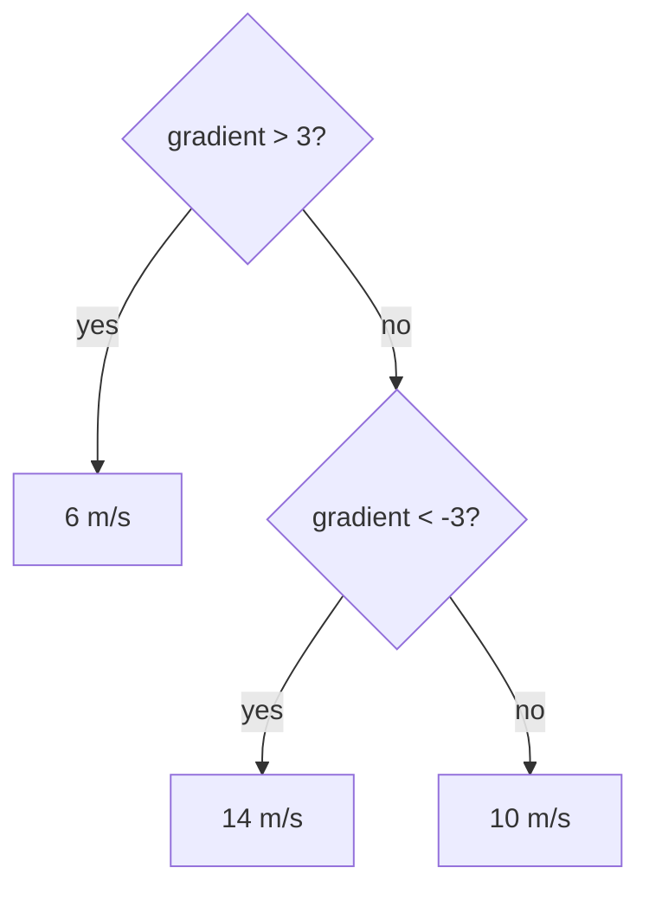

# Making decisions

## Engage

Real roads go up and down. On a climb you slow down; on a descent you fly. And at some point the race has to
end: someone crosses the line.

Both are questions the game must answer: *is this a climb?* *Has this rider finished?* Programs answer questions
with **decisions**.

## Explore

Save this as `decide.zig` and run it:

```zig
const std = @import("std");

pub fn main() void {
    const gradient_pct: f64 = 5.0;
    const climbing = gradient_pct > 3;
    std.debug.print("climbing: {}\n", .{climbing});
}
```

It prints `climbing: true`. Change the gradient to `2.0`, then to `-5.0`. What type do you think `climbing` is?

## Explain

A comparison gives a **`bool`**: `true` or `false`.

| Comparison | Means |
|---|---|
| `a == b` | equal |
| `a != b` | not equal |
| `a > b`, `a < b` | greater, less |
| `a >= b`, `a <= b` | greater or equal, less or equal |

You can combine them with `and`, `or`, and flip one with `!` (not): `!finished`.

**`if`** runs code only when a condition is true, `else` when it isn't, and `else if` checks another condition in
between. Zig checks them top to bottom and takes the first that's true:



In Zig, `if` can also *give* a value, which is handy for short choices:

```zig
const label = if (finished) "done" else "riding";
```

## Elaborate

**I do:** two decisions join the game. `finished` answers "has this rider crossed the line?", and `speedFor` picks a
speed from the road's gradient. Here's the change:

<<< @/code/diffs/05-decisions.diff

**We do:** make the change (or copy `code/steps/05-decisions`) and run it:

```sh
zig build run
```

After the first lines, you'll see:

```text
flat road:  10 m/s
5% climb:   6 m/s
5% descent: 14 m/s
```

Look at the tests: one checks a rider *exactly on* the line has finished (that's why it's `>=`, not `>`), and one
checks `speedFor(3)` is still flat. Edges like these are where bugs hide, so test them.


::: tip Check your understanding
Done reading? [Take the lesson →](/learn/basics/05-making-decisions) Quizzes on what you just read, a snippet to predict, a bug to fix, and
this step to build yourself.
:::
