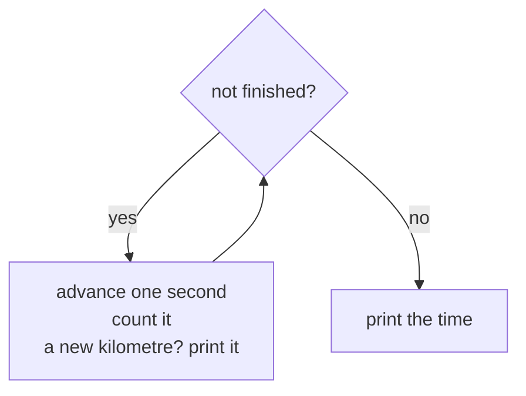

# Loops

## Engage

The rider moves three seconds, because we wrote the same two lines three times. A race of 12.5 km at 10 m/s is
1250 seconds. Nobody wants to write that out.

Computers are good at doing the same thing over and over. You just have to say *what* to repeat and *when to stop*.

## Explore

Save this as `count.zig` and run it:

```zig
const std = @import("std");

pub fn main() void {
    var second: u32 = 0;
    while (second < 5) {
        second += 1;
        std.debug.print("second {d}\n", .{second});
    }
}
```

Now change `< 5` to `< 50`. Then think: what would happen if you deleted the line `second += 1;`? (If you try it,
stop the program with Ctrl+C.)

## Explain

A **`while`** loop repeats its block as long as its condition is true. Something in the block has to change so the
condition eventually becomes false, or it never stops:



A **`for`** loop goes through a list of things, or a range of numbers:

```zig
for (1..4) |lap| {
    std.debug.print("lap {d}\n", .{lap}); // lap 1, lap 2, lap 3 (4 is not included)
}
```

Two words change the flow inside any loop: **`break`** leaves the loop at once, **`continue`** skips to the next
round.

## Elaborate

**I do:** the three copied lines become one loop that runs until `finished`. Each time the rider passes a whole
kilometre, it prints a marker. `secondsToFinish` does the same counting, without printing, so a test can check it:

<<< @/code/diffs/06-loops.diff

**We do:** make the change (or copy `code/steps/06-loops`) and run it:

```sh
zig build run
```

```text
km 1 at 100 s
km 2 at 200 s
km 3 at 300 s
...
km 12 at 1200 s
finished in 1250 s
```

Why does the test `secondsToFinish(100, 30)` expect 4, not 3.33? The loop counts whole seconds: after 3 seconds the
rider is at 90 m, not finished, so it takes a fourth.


::: tip Check your understanding
Done reading? [Take the lesson →](/learn/basics/06-loops) Quizzes on what you just read, a snippet to predict, a bug to fix, and
this step to build yourself.
:::
