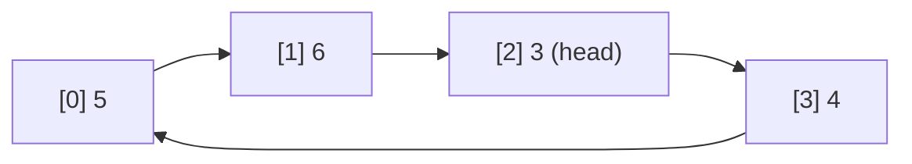

# Ring buffers

A race produces a stream of moments: who leads, who attacks, who crosses the line. A commentator doesn't keep all
of them; they remember the last few, and the newest pushes the oldest out of mind. A list that grows forever would
keep everything; an array that shifts every item along to make room would do a lot of copying for every new
moment. A **ring buffer** keeps the last N things in a fixed array, adds and drops in constant time, and never
allocates.


## A fixed array that wraps around

Keep an array, the index of the oldest item (`head`), and how many there are (`len`). The newest goes just after
the last one, and indexes **wrap around** the end with `%`:

```zig
const Ring = struct {
    items: [4]u32 = undefined,
    head: usize = 0, // where the oldest item is
    len: usize = 0,

    fn push(self: *Ring, x: u32) void {
        if (self.len == self.items.len) { // full: the oldest goes
            self.head = (self.head + 1) % self.items.len;
            self.len -= 1;
        }
        self.items[(self.head + self.len) % self.items.len] = x;
        self.len += 1;
    }
};
```

Item `i`, counting from the oldest, is at `(head + i) % items.len`:

```zig
fn at(self: *const Ring, i: usize) u32 {
    return self.items[(self.head + i) % self.items.len];
}
```

Push 1 to 6 into four places:

```text
3 4 5 6   items: { 5, 6, 3, 4 } head: 2
```

Read in order from `head`, it's the last four, oldest first; in memory, it has wrapped: 5 and 6 overwrote 1 and 2.



Nothing moves when an item is added or dropped: only `head` and `len` change.

## When it's full

A full ring has to do *something* with the next item. Pick on purpose:

| Policy | Does | Good for |
|---|---|---|
| drop the oldest | the newest always gets in | a feed, a log of recent events |
| refuse the newest | the caller is told it's full | a queue of work that mustn't lose any |
| grow | ask for more memory | a queue with no fixed limit |

## std.Deque

The standard library's ring buffer is `std.Deque` ("double-ended queue": add and take at both ends). Over an array
you give it, it never allocates:

```zig
var buf: [3]u32 = undefined;
var d: std.Deque(u32) = .initBuffer(&buf);
try d.pushBackBounded(1);  // error.OutOfMemory when full: "refuse"
d.pushBackAssumeCapacity(2); // when you've checked there's room
const oldest = d.popFront(); // ?u32: null when empty
```

`pushBackAssumeCapacity` on a full deque stops the program (`panic: reached unreachable code`), so check
`d.len == d.buffer.len` first and `popFront` to make room: that's "drop the oldest".

Started `.empty`, it grows instead, from an allocator:

```zig
var grow: std.Deque(u32) = .empty;
defer grow.deinit(gpa);
try grow.pushBack(gpa, 7);
try grow.pushFront(gpa, 99); // the other end
```

`iterator()` walks it oldest first, `front()`/`back()` peek, `at(i)` reads item `i`.

::: tip Try it
Add `fn pop(self: *Ring) ?u32` to the hand-written `Ring`, taking the oldest. Push 1 to 6, pop twice, push 7, and
print the items in order and the raw array. Where did 7 go?
:::

## Which buffer when

| You need | Use | Because |
|---|---|---|
| the last N of something | a ring buffer (`Deque` over an array) | fixed memory, O(1) add and drop |
| first in, first out with no limit | a growing `Deque` | O(1) at both ends |
| everything, in order, to keep | `ArrayList` | grows, contiguous for slicing |
| the last N, but N is huge or varies | a growing `Deque` with a cap you enforce | memory only for what's there |

What goes wrong with the wrong one: an `ArrayList` used as a queue removes from the front with `orderedRemove(0)`,
which moves every item, every time; an `ArrayList` "of the last N" never forgets and grows forever.

## In the game

The race gets a feed: the last six moments, kept in a `std.Deque` over a fixed array of lines. Each line is a
time and a short text in its own fixed buffer (so the feed allocates nothing). Below `wantsMore`:

<<< @/code/steps/22-ring-buffer/src/main.zig#feed

In `playRace`, the feed is made with the race:

<<< @/code/steps/22-ring-buffer/src/main.zig#feed-use

Every event pushes a line (`feed.push(race.clock_s, "{s} takes the lead", ...)`, and so on), and after the finish
the feed is the finale:

<<< @/code/steps/22-ring-buffer/src/main.zig#finale

The tests, at the end of the file:

<<< @/code/steps/22-ring-buffer/src/main.zig#tests

Run it (or copy `code/steps/22-ring-buffer`):

```sh
zig build run
```

```text
H crosses the line in 21:43
the finale:
  15:48  Heap takes the lead
  16:03  km 9: Heap leads
  17:40  km 10: Heap leads
  19:17  km 11: Heap leads
  20:54  km 12: Heap leads
  21:43  Heap crosses the line
```

Thirty-odd moments happened; the feed kept the last six.

Here's everything, the whole `src/main.zig` after this step:

<<< @/code/steps/22-ring-buffer/src/main.zig

<details>
<summary>What changed since the last step, as a diff</summary>

Lines starting with `+` were added, `-` removed. Only for comparing: copy the code above.

<<< @/code/diffs/22-ring-buffer.diff

</details>

::: tip Check your understanding
Done reading? [Take the lesson →](/learn/data-structures/22-ring-buffers) Quizzes on what you just read, a snippet to predict, a bug to fix, and
this step to build yourself.
:::
