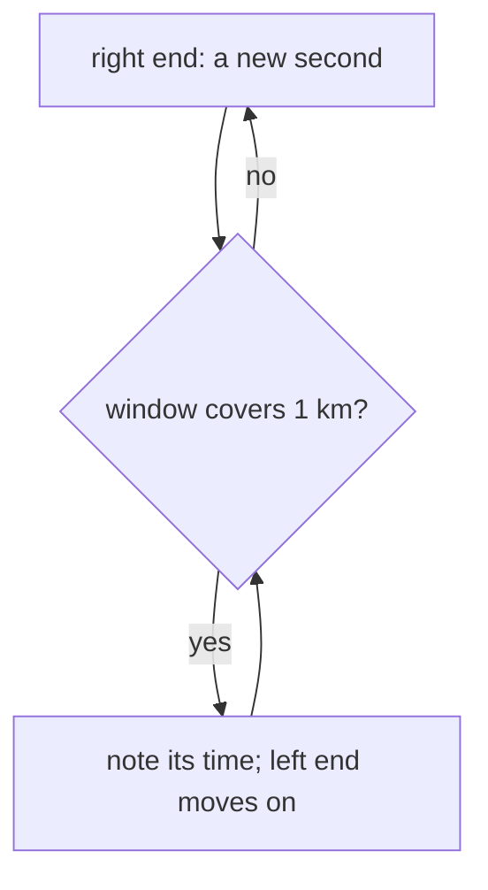

# Prefix sums and sliding windows

Two questions a race commentator asks all the time. *How much climbing between here and the line?* And *who
rode the fastest kilometre today?* Both are about a **range** (a stretch of road, a stretch of time), and the
obvious answer is to add up everything in the range, every time you're asked. Ask often enough, over long enough
ranges, and that's most of the program's work. Two small ideas make both questions cheap.

## Prefix sums: add once, subtract forever

Keep the running total: `sums[i]` is the sum of the first `i` items. Then the sum of items `a` to `b` (not
including `b`) is one subtraction, however long the range:

```zig
const per_s = [_]f64{ 10, 11, 12, 9, 8, 13, 14, 10 }; // metres ridden each second
var sums: [per_s.len + 1]f64 = undefined;            // sums[i]: metres in the first i seconds
sums[0] = 0;
for (per_s, 0..) |m, i| sums[i + 1] = sums[i] + m;
```

```text
{ 0, 10, 21, 33, 42, 50, 63, 77, 87 }
```

```zig
sums[5] - sums[2] // seconds 2, 3 and 4: 12 + 9 + 8
```

```text
seconds 2 to 5: 29 m
```

### The off-by-one

`sums` has one more entry than the items: `sums[0]` is "nothing yet". That extra zero is what makes
`sums[b] - sums[a]` right for every range, including one starting at 0. Without it, a range from the start needs a
special case, and getting that case wrong is the classic prefix-sum bug. `sums[b] - sums[a]` covers items `a`
up to `b - 1`: the same half-open range as `items[a..b]`.

### Measured

10 000 questions, each about a quarter of a 100 000-item list, in a `fast` build:

```text
adding up each time: 170.5 ms; prefix sums (building them included): 0.479 ms
```

Building the sums once costs one pass; every question after that is free. The cost: the sums must be rebuilt if
the items change.

## Sliding windows

Some questions are about *every* range of a given size: the best three seconds, the fastest kilometre. A
**window** slides along: add what enters on the right, remove what leaves on the left, and never re-add the middle.

### A fixed-size window

The best three seconds:

```zig
var window: f64 = per_s[0] + per_s[1] + per_s[2];
var best = window;
for (3..per_s.len) |i| {
    window += per_s[i] - per_s[i - 3]; // the new second in, the oldest out
    best = @max(best, window);
}
```

```text
best 3 s: 37 m from second 5
```

One addition and one subtraction per step, whatever the window's size.

### A window by distance: two pointers

"The fastest kilometre" has no fixed size in seconds: a kilometre takes 70 seconds downhill and three minutes up a
climb. Keep two **pointers**, the window's left and right ends. Move the right end on a second at a time; while the
window still covers a kilometre, note how long it took, and move the left end on. Each end only ever moves forward,
so the whole race is one pass: `n`, not `n²`.



::: tip Try it
With `per_s` and `sums` above, find the shortest number of seconds that covers at least 30 m, using two pointers
over `sums` (the window from `a` to `b` covers `sums[b] - sums[a]`). Check it by trying every pair.
:::

## Which when

| You need | Use | Because |
|---|---|---|
| many range totals over data that doesn't change | prefix sums | one pass, then O(1) per question |
| one range total, once | add it up | nothing to build |
| the best range of a fixed size | a fixed sliding window | O(1) per step |
| the best range by a condition (a distance, a total) | two pointers | each end moves forward only: O(n) |
| totals over data that changes all the time | a Fenwick or segment tree (beyond this course) | updates and queries both O(log n) |

What goes wrong with the wrong one: recomputing ranges in a loop turns `n` into `n²`; prefix sums over data that
keeps changing must be rebuilt every time (and then they're the slow way).

## In the game

Two questions. How much climbing is in a course? The climb profile is prefix sums of the metres climbed at each
segment start; the climbing between any two points is a subtraction plus the part of a segment at each end. Below
the course-map code:

<<< @/code/steps/26-prefix-sums/src/main.zig#profile

And each rider's fastest kilometre: a window of its recent seconds (a ring of up to 256 samples), the newest second
as the right end, the left end moving on while the window still covers a kilometre:

<<< @/code/steps/26-prefix-sums/src/main.zig#window

`Race` keeps a split for each rider:

<<< @/code/steps/26-prefix-sums/src/main.zig#splits-field

<<< @/code/steps/26-prefix-sums/src/main.zig#track-splits

and adds every rider's position every second:

<<< @/code/steps/26-prefix-sums/src/main.zig#splits-step

In `playRace`, under the race's start, the splits begin and the course's climbing is announced:

<<< @/code/steps/26-prefix-sums/src/main.zig#profile-use

The results gain a column. The time or gap is written into a cell first, so the column after it lines up:

<<< @/code/steps/26-prefix-sums/src/main.zig#cell

<<< @/code/steps/26-prefix-sums/src/main.zig#fastest-km

The tests, at the end of the file:

<<< @/code/steps/26-prefix-sums/src/main.zig#tests

Run it (or copy `code/steps/26-prefix-sums`):

```sh
zig build run
```

```text
race 1: Compile Pass
12.5 km, 120 m of climbing
...
results:
   1  H  Heap      21:43     fastest km 1:10
   2  B  Buffer    +88 m     fastest km 1:09
   3  A  Alloc     +125 m    fastest km 1:12
...
   8  E  Errdefer  +242 m    fastest km 1:15
```

Everyone's fastest kilometre is on the descent, around 70 seconds.

Here's everything, the whole `src/main.zig` after this step:

<<< @/code/steps/26-prefix-sums/src/main.zig

<details>
<summary>What changed since the last step, as a diff</summary>

Lines starting with `+` were added, `-` removed. Only for comparing: copy the code above.

<<< @/code/diffs/26-prefix-sums.diff

</details>

::: tip Check your understanding
Done reading? [Take the lesson →](/learn/data-structures/26-prefix-sums-and-sliding-windows) Quizzes on what you just read, a snippet to predict, a bug to fix, and
this step to build yourself.
:::
