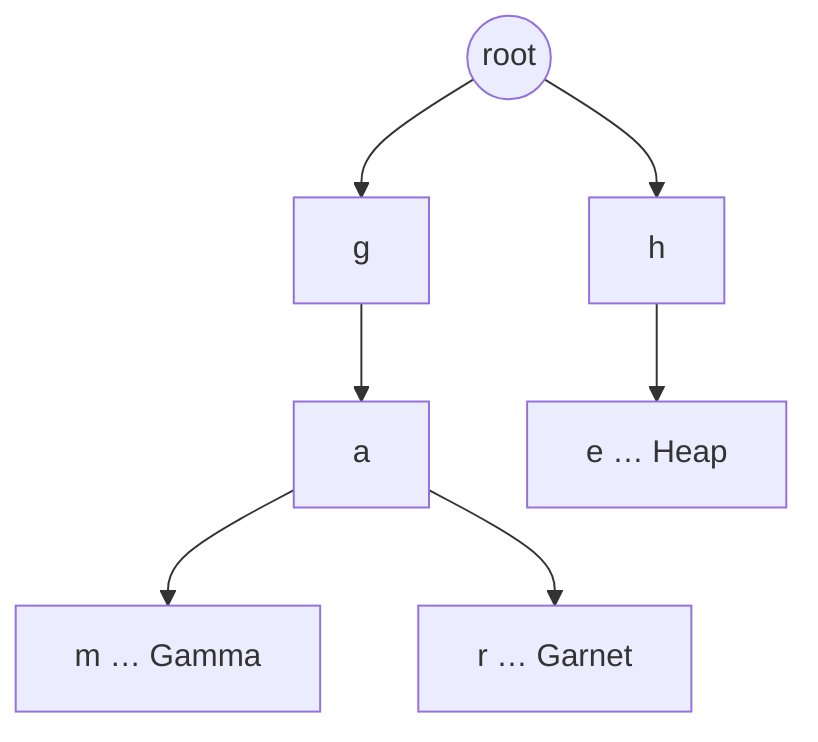

# Tries

"Which rider are you?" takes a letter. People would rather type a name, or the start of one: `he` should be enough
for Heap, and `ga`, if two riders' names start that way, should say so instead of guessing. That's **completion**:
given a prefix, which words start with it? A **trie** (from re*trie*val) is a tree built for exactly that question.

## A tree of prefixes

Each node is one letter; the path from the root to a node spells a prefix; a node where a word ends is marked with
what the word stands for. Words that start the same share the nodes of their common start.



To complete `ga`: walk `g`, then `a`; every word ending at or below that node starts with `ga`. The walk takes one
step per letter of the prefix, however many words the trie holds.

## Nodes in a flat list

A node needs its children. Giving every node its own list of children means an allocation per node and pointers
everywhere. Instead, keep all nodes in **one** `ArrayList` and join them by **index**: each node knows its first
child and its next sibling (the next child of the same parent).

```zig
const Node = struct {
    letter: u8,
    first_child: ?u32 = null,
    next_sibling: ?u32 = null,
    value: ?u8 = null, // set where a word ends
};
```

One allocation that grows, one `deinit`, and no pointers to go stale: appending a node can move the whole list
([Lists that grow](/guide/data-structures/19-lists-that-grow)), but an index still means the same node afterwards.

### Finding a child, inserting a word

A node's children are a chain of siblings:

```zig
fn child(self: *const Trie, node: u32, letter: u8) ?u32 {
    var next = self.nodes.items[node].first_child;
    while (next) |i| : (next = self.nodes.items[i].next_sibling) {
        if (self.nodes.items[i].letter == letter) return i;
    }
    return null;
}
```

To insert a word, walk its letters from the root, making each missing node on the way, and mark the last one with
the word's value.

### Completions by recursion

Every word below a node: the node's own value if it has one, then each child's, the same way. That's a
**depth-first** walk, written as a function that calls itself for each child:

```zig
fn collect(self: *const Trie, node: u32, found: []u8, n: *usize) void {
    if (self.nodes.items[node].value) |value| {
        if (n.* < found.len) { found[n.*] = value; n.* += 1; }
    }
    var next = self.nodes.items[node].first_child;
    while (next) |i| : (next = self.nodes.items[i].next_sibling) self.collect(i, found, n);
}
```

The caller gives it room for the answers (`found`). To tell "one match" from "several", room for two is enough.

## Other ways to the same answer

**A sorted list and binary search.** Sorted, all names starting with `Ga` sit together; `lowerBound` and
`upperBound` with a "compare only the first `prefix.len` letters" rule find where the run starts and ends:

```text
Gamma Garnet
```

No new structure, `log n` per lookup. It's the better choice for a list that's sorted once and rarely changes.

**`std.StaticStringMap`** for a fixed set of words known while compiling: exact lookups, no allocation.

```zig
const terrain_words = std.StaticStringMap(Terrain).initComptime(.{
    .{ "flat", .flat }, .{ "climb", .climb }, .{ "descent", .descent },
});
terrain_words.get("climb"); // .climb; "gravel" gives null
```

::: tip Try it
Insert `Gamma`, `Garnet`, `Generic` and `Heap` into a trie and print how many nodes it has
(`trie.nodes.items.len`). Work out by hand how many there would be with no shared prefixes. What did sharing save?
:::

## Which lookup when

| You need | Use | Because |
|---|---|---|
| exact lookups in a fixed set of words | `std.StaticStringMap` | built while compiling, no allocation |
| exact lookups in a changing set | a hash map | O(1) |
| prefixes, over a list sorted once | a sorted list, `lowerBound`/`upperBound` | no new structure |
| prefixes, as words are added and asked about all the time | a trie | one step per letter, shares prefixes |
| "close to" rather than "starts with" | edit distance ([Edit distance](/guide/data-structures/29-edit-distance)) | typos aren't prefixes |

## In the game

The rider question takes a letter, a name, or the start of a name, found in a trie of the roster's names. Below the
edit-distance code:

<<< @/code/steps/30-tries/src/main.zig#trie

In `main`, the question now says `(A-H, or a name)`, and after it, the answer is tried as a name:

<<< @/code/steps/30-tries/src/main.zig#pick-by-name

The tests, at the end of the file:

<<< @/code/steps/30-tries/src/main.zig#tests

Run it (or copy `code/steps/30-tries`) and answer `err`:

```sh
zig build run
```

```text
Which rider are you (A-H, or a name)? err
Good luck, Ada! Ada rides as E today.
```

And a name no rider has:

```text
Which rider are you (A-H, or a name)? zed
note: no one rider's name starts "zed"; you're rider A
```

Here's everything, the whole `src/main.zig` after this step:

<<< @/code/steps/30-tries/src/main.zig

<details>
<summary>What changed since the last step, as a diff</summary>

Lines starting with `+` were added, `-` removed. Only for comparing: copy the code above.

<<< @/code/diffs/30-tries.diff

</details>

::: tip Check your understanding
Done reading? [Take the lesson →](/learn/data-structures/30-tries) Quizzes on what you just read, a snippet to predict, a bug to fix, and
this step to build yourself.
:::
