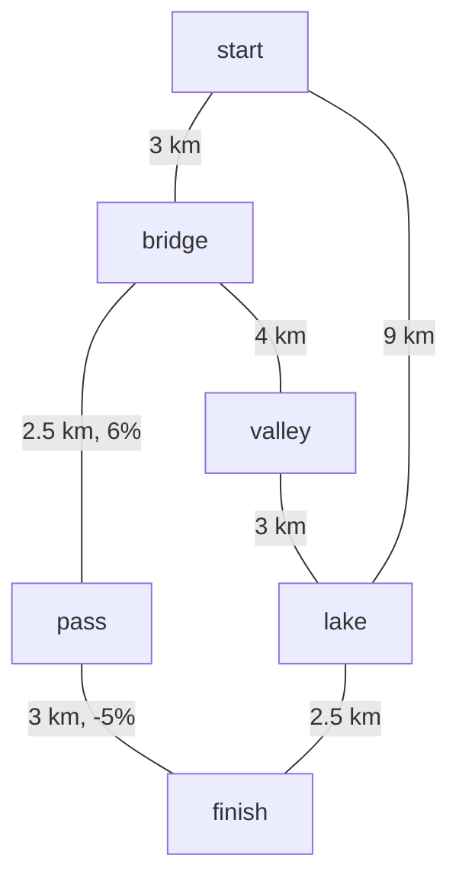

# Graphs

So far every course is a line of text someone wrote. Real routes come from a map: places, and roads between them,
some short, some long, some over a pass. "Plan me a race from the start to the finish" means choosing roads, and
two reasonable people choose differently: fewest roads (fewest turns to remember), or shortest distance. A map is a
**graph**: **nodes** (the places) joined by **edges** (the roads), and those two questions are its two most famous
algorithms.



(And `island`, with no roads at all.)

## Storing a graph

**Adjacency lists**: for each place, a list of the roads leaving it. Finding a place's roads is direct; memory is one
entry per road (two for a road you can ride both ways).

```zig
const Road = struct { to: Place, length_m: f64, gradient_pct: f64 };
roads: [place_count]std.ArrayList(Road),
```

**An adjacency matrix**: a square table, `road_m[a][b]` the road from `a` to `b`, or `null`.

```zig
var road_m: [7][7]?f64 = @splat(@splat(null));
road_m[0][1] = 3000;
```

"Is there a road from `a` to `b`?" is one lookup. But it needs a cell for every *pair* of places: 784 bytes for
seven places, and for ten thousand places, 1600 MB, nearly all of it `null`. Maps have few roads per place, so they
use lists.

## Fewest roads: breadth-first search

Visit the start, then every place one road away, then every place two roads away, and so on: a **queue** keeps
them in that order ([Queues](/guide/data-structures/23-queues-and-priority-queues)). The first time the search
reaches the finish, it's by the fewest roads.

- Mark each place **seen** when it's first queued. Without that, a loop in the map (start, bridge, valley, lake,
  start) sends the search round it forever.
- Record where each place was reached **from**. That's all you need to rebuild the route afterwards.
- If the queue runs dry first, the finish can't be reached: return `null`.

## Shortest distance: Dijkstra's algorithm

Fewest roads ignores length: start → lake → finish is two roads but 11.5 km. For distance, replace the queue with
a **priority queue** of places by how far they are from the start along the best route found so far, nearest first.
When a place comes out, its distance is final (anything still in the queue is further, and roads have no negative
length). For each road leaving it, if going that way reaches a neighbour sooner than known, note the new distance
and where it came from, and queue it.

A place can be queued more than once (a longer way found first, a shorter one later). When the older, longer entry
comes out, skip it: `if (visit.distance_m > distance_m[place]) continue;`.

## Rebuilding the route

Both searches end with "where was each place reached from". Walk that from the finish back to the start, then turn
it round:

```zig
var at = to;
while (true) {
    try route.append(gpa, at);
    if (at == from) break;
    at = previous[@backingInt(at)].?;
}
std.mem.reverse(Place, route.items);
```

## The two answers

```text
Route Planner: start > bridge > pass > finish (fewest roads: start > lake > finish)
```

Three roads and 8.5 km, or two roads and 11.5 km. Neither is wrong: they answer different questions. Weigh the edges
by time instead of distance (a climb is slow), and Dijkstra answers a third.

::: tip Try it
Add a road from `valley` to `finish` of 2 km and run the planner again. Which route does each search choose now?
Then remove every road to `finish` and check both return `null`.
:::

## Which search when

| You want | Use | Because |
|---|---|---|
| the fewest steps (every edge the same) | breadth-first search, a queue | first arrival is the fewest steps |
| the shortest by weight (distance, time) | Dijkstra, a priority queue | nearest first; final when it comes out |
| any route at all, or to visit everything | depth-first search, a stack or recursion | simplest |
| weights that can be negative | Bellman-Ford (beyond this course) | Dijkstra's "final" breaks |
| a sparse graph (few edges per node) | adjacency lists | memory per edge |
| a dense graph, or "is there an edge?" constantly | an adjacency matrix | one lookup |

## In the game

A course map, both searches, and turning a route into course text. Below the edit-distance code:

<<< @/code/steps/31-graphs/src/main.zig#map

In `main`, before the course question, the shortest route becomes the third course, Route Planner:

<<< @/code/steps/31-graphs/src/main.zig#plan-route

The question offers all three courses, and `closestCourse` now takes the list to search:

<<< @/code/steps/31-graphs/src/main.zig#pick-course

<<< @/code/steps/31-graphs/src/main.zig#closest

and the races rotate through all three:

<<< @/code/steps/31-graphs/src/main.zig#loop-plan

The tests: the two searches disagree on this map, an island can't be reached, and a planned route races:

<<< @/code/steps/31-graphs/src/main.zig#tests

Run it (or copy `code/steps/31-graphs`), and race Route Planner first:

```sh
zig build run
```

```text
Route Planner: start > bridge > pass > finish (fewest roads: start > lake > finish)
Which course first? (Compile Pass, Linker Loop, Route Planner) route planer
note: no course "route planer"; did you mean "Route Planner"? racing it

race 1: Route Planner
8.5 km, 150 m of climbing; terrain: flat climb descent
...
winner: E (Errdefer)
```

On the hilliest course, Errdefer, the best climber, wins for the first time.

Here's everything, the whole `src/main.zig` after this step:

<<< @/code/steps/31-graphs/src/main.zig

<details>
<summary>What changed since the last step, as a diff</summary>

Lines starting with `+` were added, `-` removed. Only for comparing: copy the code above.

<<< @/code/diffs/31-graphs.diff

</details>

::: tip Check your understanding
Done reading? [Take the lesson →](/learn/data-structures/31-graphs) Quizzes on what you just read, a snippet to predict, a bug to fix, and
this step to build yourself.
:::
