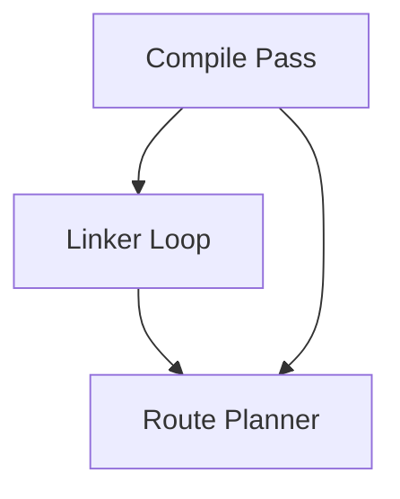

# Topological sort

A season isn't three courses in any order. Linker Loop opens once you've raced Compile Pass; Route Planner once
you've raced both. "This before that" rules are everywhere: a build compiles a library before the program that uses
it (Part 10, the build system, has a whole graph of them), a recipe whisks before it folds, a
course is planned before it's raced. Given the rules, which order satisfies all of them? That's a **topological
sort**, and its other job is just as useful: noticing when the rules can't be satisfied at all.

## Dependencies are a graph

Each course is a node; each rule "B after A" is an edge from A to B. The order you want lists every node after all
the nodes with edges into it.



An order exists only if the edges never lead round in a **circle** (a cycle): "Linker Loop after Route Planner" and
"Route Planner after Linker Loop" can't both be satisfied. A graph with arrows and no circles is a **DAG** (directed
acyclic graph).

## Kahn's algorithm: whoever's ready goes next

1. For every course, count how many courses it's waiting for.
2. Every course waiting for none is **ready**: put it in a queue.
3. Take a ready course and add it to the order. Every course that was waiting for it now waits for one fewer; any
   that reach zero become ready.
4. When nothing is ready, stop. If every course made it into the order, that's the answer. If some didn't, they're
   waiting for each other: a circle.

The game's version is in the step below. Each course is ready once, and each rule is looked at once per course it
comes after: for `n` courses and `r` rules, about `n × r` in this simple form, `n + r` with adjacency lists
([Graphs](/guide/data-structures/31-graphs)).

### Ties: make the order the same every time

When several courses are ready together, any of them can go next: many orders are valid. A plain queue gives them
in whatever order they became ready, which changes when the rules are listed differently. The game takes ready
courses from a **priority queue** by their place in the course list, so the same rules always give the same
season, and a course with no rules keeps its place.

## The depth-first version

Another way: to place a course, first place everything it needs (recursion does that), then add the course. Mark
courses being worked on as `open`; meeting an `open` course again means you've gone round a circle.

```zig
fn visit(course: usize, rules: []const Unlock, marks: []Mark, order: *std.ArrayList(usize), gpa: std.mem.Allocator) !void {
    switch (marks[course]) {
        .done => return,
        .open => return error.Circle, // we're already inside this course's needs: a circle
        .new => {},
    }
    marks[course] = .open;
    for (rules) |rule| if (rule.course == course) try visit(rule.after, rules, marks, order, gpa);
    marks[course] = .done;
    try order.append(gpa, course); // after everything it needs
}
```

With the season's rules, visiting each course in turn:

```text
Compile Pass; Linker Loop; Route Planner;
```

With "Linker Loop after Route Planner" and "Route Planner after Linker Loop", it stops with `Circle` after placing
Compile Pass.

Three marks, not two: `done` means "placed, skip it", `open` means "on the way to placing it". With only
"seen or not", the search couldn't tell a course it's already finished from one it's in the middle of.

::: tip Try it
Add a fourth course, "Heap Hill", with the rules "Heap Hill after Linker Loop" and "Compile Pass after Heap Hill".
Is there a season now? Which courses does Kahn's algorithm manage to order before it gets stuck?
:::

## Which when

| You need | Use | Because |
|---|---|---|
| an order that respects "this before that" | topological sort | every rule satisfied |
| the same order every run | Kahn's with a priority queue on a fixed key | ties broken the same way |
| to report *which* things are stuck in a circle | Kahn's: whatever's left over | the leftovers are the circle (and what waits on it) |
| to stop at the first circle and say where | depth-first with three marks | finds the edge that closes it |
| "what must happen before X?" only | a search back from X | no need to order everything |

What goes wrong with the wrong one: sorting by a number ("Route Planner is level 3") breaks the day a rule changes
and nobody updates the numbers; an order computed with a plain queue changes whenever the rules are reordered in the
file.

## In the game

Courses unlock in a season. Below the map code, the rules as text, reading them, and Kahn's algorithm:

<<< @/code/steps/32-topological-sort/src/main.zig#toposort

In `main`, after the third course is planned, the season:

<<< @/code/steps/32-topological-sort/src/main.zig#season

and the races follow the season from the course you picked:

```zig
const start_at = std.mem.indexOfScalar(usize, season, first_course).?;
const plan = all_courses[season[(start_at + race_no) % season.len]];
```

The built-in rules have no circle, so a circle here is a bug in the game's own data: `main` returns
`error.CircularUnlocks` rather than racing something wrong.

The tests: every rule is respected, ties keep list order, a rule can move a course first, and a circle has no
season:

<<< @/code/steps/32-topological-sort/src/main.zig#tests

Run it (or copy `code/steps/32-topological-sort`), pick Route Planner and race three times:

```sh
zig build run
```

```text
Route Planner: start > bridge > pass > finish (fewest roads: start > lake > finish)
season: Compile Pass > Linker Loop > Route Planner
...
race 1: Route Planner
...
race 2: Compile Pass
...
race 3: Linker Loop
```

Here's everything, the whole `src/main.zig` after this step:

<<< @/code/steps/32-topological-sort/src/main.zig

<details>
<summary>What changed since the last step, as a diff</summary>

Lines starting with `+` were added, `-` removed. Only for comparing: copy the code above.

<<< @/code/diffs/32-topological-sort.diff

</details>

::: tip Check your understanding
Done reading? [Take the lesson →](/learn/data-structures/32-topological-sort) Quizzes on what you just read, a snippet to predict, a bug to fix, and
this step to build yourself.
:::
