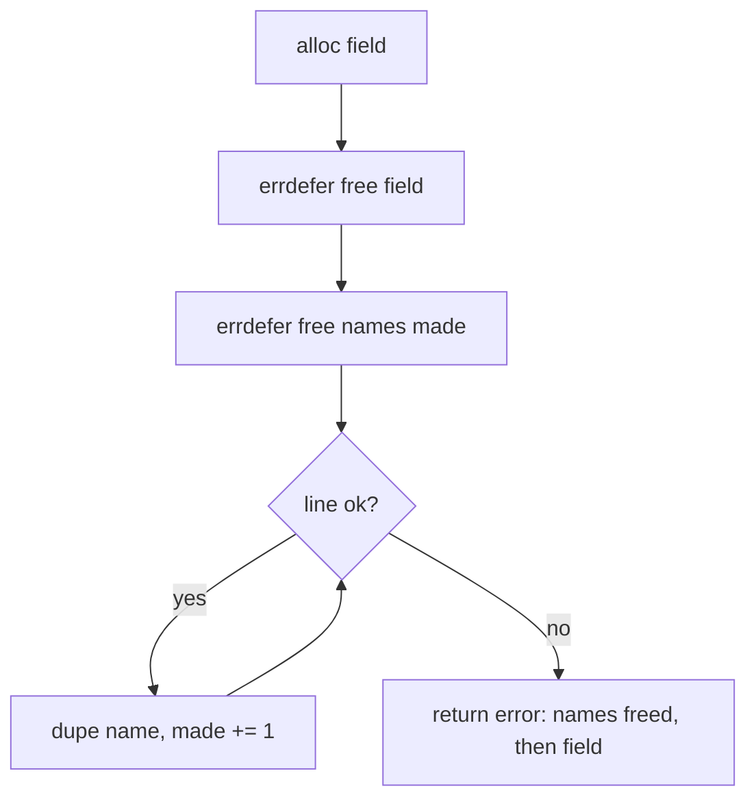

# defer and errdefer

Rider H has always been "H". The roster gives the riders names (Alloc, Buffer, Comptime and so on), and each name
is a string allocated while the roster is read. Eight riders means nine allocations, the field and eight names.
Any of them can fail, and a bad line halfway down the roster stops the reading. When that happens, everything made
so far has to be given back, and nothing made yet must be freed. Writing that cleanup by hand at every `return`
is how leaks happen. Zig has two statements that put the cleanup next to the allocation instead.

## defer: when this scope ends

`defer` runs its statement when the current **scope** (the `{ }` it's in) ends, however it ends: falling off
the end, `return`, `break`, or an error coming back through `try`.

```zig
const speeds = try gpa.alloc(f64, 8);
defer gpa.free(speeds);
// ... use speeds; every way out of this function frees them
```

Put the `defer` on the line after the allocation it undoes, so each allocation and its cleanup read as a pair, and
a new `return` added later can't skip the free.

### Last in, first out

Several defers run in reverse order: the last one written runs first.

```zig
defer std.debug.print("1 ", .{});
defer std.debug.print("2 ", .{});
std.debug.print("body ", .{});
```

```text
body 2 1
```

That's the order you want: things made later often depend on things made earlier (a name inside a field), so
they're undone first.

### Per scope, not per function

A `defer` belongs to the innermost scope. In a loop, that's one round:

```zig
for (0..3) |i| {
    defer std.debug.print("end {d}, ", .{i});
    std.debug.print("lap {d} ", .{i});
}
```

```text
lap 0 end 0, lap 1 end 1, lap 2 end 2,
```

Memory allocated in a loop round and deferred there is freed at the end of that round. To keep it after the loop,
don't defer it inside the loop.

### What a defer can't do

A defer runs while the scope is already ending, so it can't change how it ends:

```text
error: cannot return from defer expression
error: 'try' not allowed inside defer expression
```

Cleanup that can fail has to handle its own error (`catch {}`), or not be cleanup.

## errdefer: only if it fails

`errdefer` runs only when the scope ends by **returning an error**. On success it does nothing.

```zig
fn mayFail(fail: bool) !void {
    errdefer std.debug.print("errdefer ", .{});
    defer std.debug.print("defer ", .{});
    if (fail) return error.Flat;
    std.debug.print("ok ", .{});
}
```

```text
ok defer
defer errdefer
```

Success: the body and the `defer`. Failure: both, in last-in-first-out order (they share one queue).

That's exactly what a function that *returns* allocated memory needs: on success the caller owns it, so freeing
it would be a bug; on failure the caller gets nothing, so the function must free it.

```zig
const field = try gpa.alloc(Rider, count);
errdefer gpa.free(field); // the caller owns it on success; we free it on failure
```

## Freeing a half-built structure

The field holds riders, and each rider holds a name the loader allocated. If line 5 is bad, names 1 to 4 exist and
names 5 to 8 don't. Keep a count of what's been made, and let the `errdefer` free exactly those:

```zig
var made: usize = 0;
errdefer for (field[0..made]) |rider| gpa.free(rider.full_name);
```

Written after `errdefer gpa.free(field)`, it runs before it: names first, then the field that held them. Freeing
the field first would leave nothing to find the names with.



## Testing every allocation failure

A test with a good roster never sees an allocation fail, so it never runs the `errdefer`s. 
`std.testing.checkAllAllocationFailures` does: it runs your function once to count its allocations, then again
for each one, making that one fail, and checks every run returns `error.OutOfMemory` and leaks nothing.

```zig
fn loadAndFree(gpa: std.mem.Allocator, text: []const u8) !void {
    const field = try loadField(gpa, text);
    freeField(gpa, field);
}

test "whichever allocation fails, loadField leaks nothing" {
    try std.testing.checkAllAllocationFailures(std.testing.allocator, loadAndFree, .{roster_text});
}
```

Delete the names' `errdefer` and run the tests: the bad-line test now fails with what leaked, and where (paths
shortened):

```text
+- run test 47 pass, 1 fail (48 total); 3 leaks
error: 'main.test.a bad line is an error, and what was made before it is freed' leaked 2 allocations:
       [SafeAllocator] (err): leaked [addr: 70a2a31d8270, len: 5 (0x5) align: 1] allocated at:
       .../std/mem/Allocator.zig:481:40: in dupe
       src/main.zig:351:38: in loadField (main.zig)
                   .full_name = try gpa.dupe(u8, full_name), // a copy: the field mustn't depend on `text`
```

::: tip Try it
In a scratch file, write a function that allocates three slices with `try`, each followed by an `errdefer` that
prints which one it frees, and make the third allocation fail by giving it a `FixedBufferAllocator` that's too
small. Which messages print, and in what order?
:::

## Which cleanup when

| The memory | Clean up with | Because |
|---|---|---|
| used only inside this function | `defer free` right after the allocation | freed on every way out |
| returned to the caller | `errdefer free` right after the allocation | freed only if the caller won't get it |
| several pieces, built in a loop | a count of what's made, and one `errdefer` loop over them | frees what exists, nothing else |
| one per loop round | `defer` inside the loop | freed at the end of each round |
| owned by a struct | a `deinit`/`free...` function, deferred by its owner | one place knows how to free it all |

What goes wrong with the wrong one: `defer` on memory you return frees it under the caller's feet (a use after
free). No `errdefer` leaks on the error path, which ordinary tests never take.

## In the game

The field comes from a roster: one rider a line, its speed on the flat, its speed on a climb, and its name.
`Rider` gains the name:

<<< @/code/steps/18-defer-errdefer/src/main.zig#full-name

The roster, the loader and its free, below `parseCourse`. `RosterError` is `ParseError` plus two more errors:
`||` merges error sets.

<<< @/code/steps/18-defer-errdefer/src/main.zig#roster

`Race` can be made from a loaded field (copied into its eight places; Part 4's next page lifts the limit). Above
`init`:

<<< @/code/steps/18-defer-errdefer/src/main.zig#from-field

In `main`, the riders come from the roster, freed when `main` ends:

<<< @/code/steps/18-defer-errdefer/src/main.zig#field

and the winner is named:

<<< @/code/steps/18-defer-errdefer/src/main.zig#winner

The tests, at the end of the file:

<<< @/code/steps/18-defer-errdefer/src/main.zig#tests

Run it (or copy `code/steps/18-defer-errdefer`):

```sh
zig build run
```

```text
H crosses the line in 21:43
winner: H (Heap)
you (H) crossed the line!
```

Here's everything, the whole `src/main.zig` after this step:

<<< @/code/steps/18-defer-errdefer/src/main.zig

<details>
<summary>What changed since the last step, as a diff</summary>

Lines starting with `+` were added, `-` removed. Only for comparing: copy the code above.

<<< @/code/diffs/18-defer-errdefer.diff

</details>

::: tip Check your understanding
Done reading? [Take the lesson →](/learn/memory/18-defer-and-errdefer) Quizzes on what you just read, a snippet to predict, a bug to fix, and
this step to build yourself.
:::
