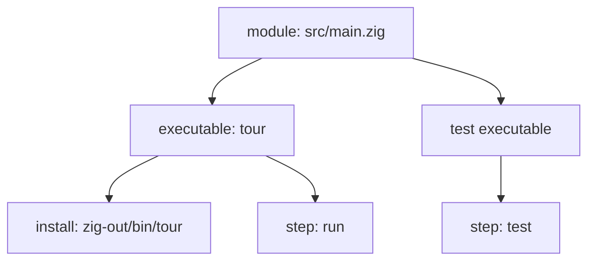

# Build, run and test

The game prints its name. Soon it will print race cards, results and a whole race, and every change risks breaking
something that used to work. You could run the game and look, every time. Or the computer could check for you, in
a second, every time: that's a **test**. This page takes `build.zig` apart, then writes the game's first test.

## build.zig: how a project is built

`build.zig` is a Zig program whose job is to describe how to build yours. It doesn't build anything itself: it
draws a **build graph**, steps that depend on each other, and `zig build` runs the parts you ask for.



Here's the course's `build.zig`, line by line:

<<< @/code/steps/02-first-test/build.zig

- **`target`** and **`optimize`** read the standard options, so `zig build -Dtarget=...` and
  `zig build -Doptimize=...` work.
- **`createModule`**: your code, starting at `src/main.zig`. A module is a unit of code other things can use.
- **`addExecutable`**: a program built from that module, called `tour`. **`installArtifact`** copies it into
  `zig-out/bin/` when you run `zig build`.
- **`addRunArtifact`** + **`b.step("run", ...)`**: a step called `run` that builds the program and runs it.
  **`addPassthruArgs`** hands anything after `--` to the program: `zig build run -- --fast`.
- **`addTest`** + **`b.step("test", ...)`**: a test program built from the same module, which runs every `test`
  block in it.

Ask the build what it can do:

```sh
zig build --help
```

```text
Steps:
  install (default)            Copy build artifacts to prefix path
  uninstall                    Remove build artifacts from prefix path
  run                          Run the game
  test                         Run the tests
```

The descriptions are the second argument of each `b.step(...)`. Built files go to **`zig-out/`**; Zig's working
files and cache go to **`.zig-cache/`**. Both can be deleted at any time: the next build makes them again.

## Optimize modes: what you trade

`-Doptimize=` chooses what the compiler aims for. The same game, built four ways:

| Mode | Aims for | Safety checks | The game's size |
|---|---|---|---|
| `debug` (the default) | fast compiling, clear errors | on | 12.4 MB |
| `safe` | speed, keeping the checks | on | 4.0 MB |
| `fast` | speed above all | **off** | 4.1 MB |
| `small` | the smallest program | **off** | 0.15 MB |

**Safety checks** catch mistakes while the program runs: reading past the end of an array, a number too big for
its type. With them off, the mistake isn't caught, and the program carries on with garbage. One program that reads
one past the end of a 3-item array, run in three modes:

```text
debug:  thread 634550 panic: index out of bounds: index 3, len 3
safe:   thread 634644 panic: index out of bounds: index 3, len 3
fast:   0
```

`fast` printed a wrong answer and kept going. Work in `debug`; ship in `safe` unless you've measured that you need
`fast`.

::: tip Try it
`zig build -Doptimize=small`, then look at the size of `zig-out/bin/tour` (`ls -l zig-out/bin`). Then build in
`debug` again.
:::

## Tests

A **test** is a block of code that checks something is true. It lives next to the code it checks, and only runs
under `zig build test` (never when you run the game):

```zig
test "two plus two" {
    try std.testing.expect(2 + 2 == 4);
}
```

The name in quotes says what's being checked; when a test fails, that name is what you see, so make it a sentence
about the rule: `"the game has a title"`, not `"test1"`.

### The checks in std.testing

| Check | Passes when | When it fails, it shows |
|---|---|---|
| `expect(ok)` | `ok` is `true` | only which test failed |
| `expectEqual(expected, actual)` | the two are equal | `expected 4, found 5` |
| `expectEqualStrings(expected, actual)` | two texts are the same | both texts, and where they first differ |

Always put the value you **expect** first, then what the code gave you. Every check can fail, so each needs `try`.

What failures look like, from three failing tests:

```text
1/4 t.test.expect...FAIL (TestUnexpectedResult)
2/4 t.test.expectEqual...expected 4, found 5
FAIL (TestExpectedEqual)
3/4 t.test.expectEqualStrings...
====== expected this output: =========
Terminal Tour␃

======== instead found this: =========
Terminal Tor␃
...
First difference occurs on line 1:
```

`expect` only says "false"; `expectEqual` and `expectEqualStrings` say what they wanted and what they got. Use the
one that tells you the most.

### Running tests

| Command | Runs |
|---|---|
| `zig build test` | every test in the project (quiet when they all pass) |
| `zig build test --summary all` | the same, with a summary: `1/1 tests passed` |
| `zig test file.zig` | the tests in one file, no `build.zig` needed |
| `zig test file.zig --test-filter title` | only tests whose name contains `title` |

Zig remembers results: run `zig build test --summary all` twice without changing anything and the second time the
count disappears (`Build Summary: 3/3 steps succeeded`), because nothing changed so nothing ran. Change the code
and they run again.

::: tip Try it
Write a test that fails on purpose with `expectEqual(@as(u32, 4), 2 + 3)`, run it, and read the message. Then fix
the test.
:::

## In the game

The game's name will be needed in more than one place (on the screen and in a test), so it moves into a function,
`title()`, that returns it. Add it below `main`:

<<< @/code/steps/02-first-test/src/main.zig#title

In `main`, print it instead of the fixed text:

<<< @/code/steps/02-first-test/src/main.zig#print

And its test, at the end of the file:

<<< @/code/steps/02-first-test/src/main.zig#test

Run the tests (or copy `code/steps/02-first-test` and run them there):

```sh
zig build test --summary all
```

```text
Build Summary: 3/3 steps succeeded; 1/1 tests passed
```

Now break it: change `"Terminal Tour"` in `title()` to `"Terminal Tor"`, run the tests, and read what they say.
Put it back.

Here's everything, the whole `src/main.zig` after this step:

<<< @/code/steps/02-first-test/src/main.zig

<details>
<summary>What changed since the last step, as a diff</summary>

Lines starting with `+` were added, `-` removed. Only for comparing: copy the code above.

<<< @/code/diffs/02-first-test.diff

</details>

::: tip Check your understanding
Done reading? [Take the lesson →](/learn/start/02-build-run-test) Quizzes on what you just read, a snippet to predict, a bug to fix, and
this step to build yourself.
:::
