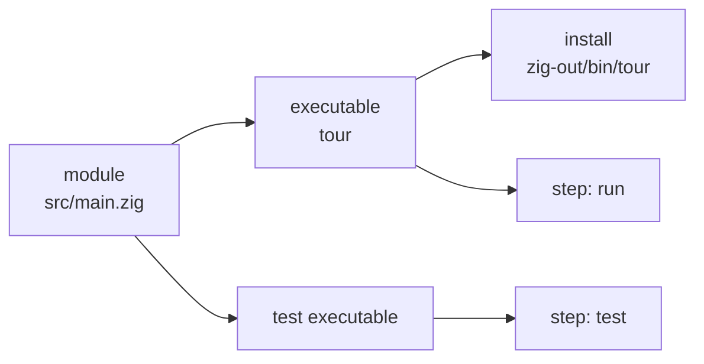

# Build, run and test

## Engage

Your game prints its name. Soon it will print race cards, results and a whole race. Every time you change
something, how do you know you didn't break the name?

You could run the game and look. Or you could have the computer check it for you, every time, in a second.
That's a **test**.

## Explore

Inside your project from the last lesson, ask the build what it can do:

```sh
zig build --help
```

Near the top, under **Steps**, find `run` and `test`. Each one is a *step* your `build.zig` describes. Try
`zig build` on its own too: it builds the game without running it, and puts it in `zig-out/bin/`. Run that file
directly: `./zig-out/bin/tour` (or `zig-out\bin\tour.exe` on Windows).

## Explain

`build.zig` is a Zig program that describes how to build your project, as a set of steps that depend on each
other:



- The **module** is your code, starting at `src/main.zig`.
- The **executable** is the program built from it, called `tour`.
- **run** builds the executable and runs it. **test** builds a special program from the same module that runs
  every `test` block in it.

A **test** is a block of code that checks something is true:

```zig
test "two plus two" {
    try std.testing.expect(2 + 2 == 4);
}
```

If the check fails, the test fails, and `zig build test` tells you which one and why.

## Elaborate

**I do:** the game's name is going to be used in more than one place (the screen and the test), so it moves into
a function, `title()`, that returns it. Here's the new code, piece by piece, and where each goes.

Add `title()` below `main`:

<<< @/code/steps/02-first-test/src/main.zig#title

In `main`, print it instead of the fixed text:

<<< @/code/steps/02-first-test/src/main.zig#print

And its test, at the end of the file:

<<< @/code/steps/02-first-test/src/main.zig#test

**We do:** make the same changes in your project (or copy `code/steps/02-first-test`).

Run the test:

```sh
zig build test --summary all
```

```text
Build Summary: 3/3 steps succeeded; 1/1 tests passed
```

Run it again and the count disappears (`Build Summary: 3/3 steps succeeded`): nothing changed, so Zig reuses the
last result instead of running the tests again. Change the code and they run again.

Now break it on purpose: change `"Terminal Tour"` in `title()` to `"Terminal Tor"` and run the test again. Read
what it says: what it expected, and what it found. Put the name back.

<details>
<summary>The whole <code>src/main.zig</code> after this step</summary>

<<< @/code/steps/02-first-test/src/main.zig

</details>

::: tip Check your understanding
Done reading? [Take the lesson →](/learn/start/02-build-run-test) Quizzes on what you just read, a snippet to predict, a bug to fix, and
this step to build yourself.
:::
