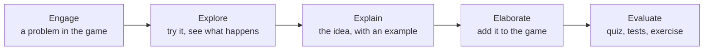

# How the course works

## One game, one step at a time

Every lesson adds one step to the same game. The code for each step lives in its own folder in the course
repository, `code/steps/NN-name/`, and each one is a complete project: copy the folder (or clone the whole
repository), then run `zig build run` and `zig build test` inside it. If you get stuck, take the next step's
folder and carry on.

Each lesson shows exactly what changed since the last step, so you can type it in yourself (recommended:
you learn more) or copy it.

## Five steps in every lesson

A lesson shows one step at a time:

- **Engage**: something the game can't do yet, or does wrong.
- **Explore**: run the current step and poke at it before any explanation.
- **Explain**: the idea itself, with a small example, a picture when it helps, and the output you should see.
- **Elaborate**: the change to the game. First you watch it worked through, then you build it with the code in
  front of you.
- **Evaluate**: a quiz, the step's tests (`zig build test`), and an exercise to do on your own, with a hint.

## Show what you know, your way

Exercises accept more than one answer: if yours passes the tests and does what was asked, it's right. The last
lesson of each part ends with something to create on your own: your own race card, your own computer tactic,
your own save format.

::: tip Progress stays with you
Steps you finish, quiz answers and XP are kept in this browser only: no account, nothing sent anywhere. See
[your progress](/learn/progress).
:::

## What you need

A computer running Linux, macOS or Windows, a terminal, a text editor, and Zig 0.17. [Set up Zig →](/start/set-up)
