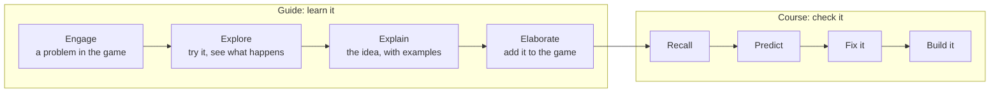

# How the course works

## One game, one step at a time

Every lesson adds one step to the same game. The code for each step lives in its own folder in the course
repository, `code/steps/NN-name/`, and each one is a complete project: copy the folder (or clone the whole
repository), then run `zig build run` and `zig build test` inside it. If you get stuck, take the next step's
folder and carry on.

Each lesson shows exactly what changed since the last step, so you can type it in yourself (recommended:
you learn more) or copy it.

## Read in the Guide, check in the Course

Every idea comes in two halves:

**The Guide** teaches, in ordinary pages you can read at your own pace, with the code right where it's explained:

- **Engage**: something the game can't do yet, or does wrong.
- **Explore**: a small program to run and poke at before any explanation.
- **Explain**: the idea itself, with examples, pictures, and the real output and errors you'll see.
- **Elaborate**: the change to the game. First you watch it worked through, then you build it with the code in
  front of you.

**The Course** checks you've got it, one step at a time, without re-teaching:

- **Recall**: quick questions on what you read.
- **Predict**: a short program: what does it print, or which error does it give?
- **Fix it**: a broken program and its error: which fix is right?
- **Build it**: an exercise on the game to do on your own, with a hint, checked by `zig build test`.
- **Stretch**: at the end of each part, something to create on your own.

## Show what you know, your way

Exercises accept more than one answer: if yours passes the tests and does what was asked, it's right. The last
lesson of each part ends with something to create on your own: your own race card, your own computer tactic,
your own save format.

::: tip Progress stays with you
Steps you finish, quiz answers and XP are kept in this browser only: no account, nothing sent anywhere. See
[your progress](/learn/progress).
:::

## What you need

A computer running Linux, macOS or Windows, a terminal, a text editor, and Zig 0.17. [Set up Zig →](/start/set-up)
